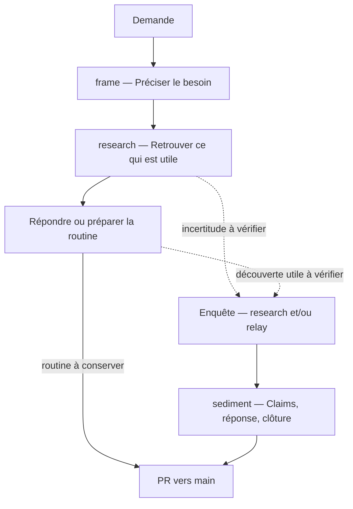

# chu-data-knowledge

On travaille de plus en plus avec un agent IA, et ce qu'on apprend ensemble reste dans la conversation, puis se perd. Ce dépôt est un lieu commun : chacun, avec son agent, y sédimente ce qu'il découvre sur les données du CHU, avec les preuves. La conversation suivante, la sienne ou celle d'un collègue, part de là.

Les preuves comptent ici plus qu'ailleurs : l'infrastructure n'est pas documentée, et même la documentation de l'éditeur peut se tromper. Sans preuves, une erreur faite dans une conversation passerait dans toutes les suivantes.

- **Qui :** des personnes du DIM et de l'entrepôt de données. Un projet d'équipe, pas institutionnel.
- **Comment :** les agents écrivent ; les personnes posent les questions et décident. Les agents n'atteignent pas l'hôpital : une personne exécute leurs requêtes à l'intérieur et ne rapporte que des résultats agrégés. Aucune donnée de patient n'entre ici.
- **Ensuite (vers avril 2027) :** des agents qui travaillent directement dans l'hôpital.

## Commencer

```text
pip install -r requirements.txt
python checks/check.py
```

Puis poser une question à son agent : il commence par la cadrer avec vous.

- **Codex** lit AGENTS.md et .agents/skills/.
- **Claude Code** lit CLAUDE.md, qui renvoie à AGENTS.md, et .claude/skills/.
- **App web :** créer un projet avec l'instruction « au début, lis AGENTS.md du dépôt et suis ses instructions ». À vérifier par un essai.

## Le parcours d'une demande

Les skills accompagnent la demande selon ce qu'elle nécessite.



Les flèches pointillées sont des possibilités, pas des étapes obligatoires. Une même demande peut aboutir à une réponse, une routine et des claims, selon ce que le travail révèle. Pour une routine, on conserve le script paramétrique et sa méthode ; les résultats de ses exécutions restent à l'hôpital (method/queries.md, « Une routine »). Un mainteneur fusionne la PR.

## Finir une session

Quand vous vous arrêtez, à n'importe quelle étape, lancez la retro : `/retro` dans Claude Code ; avec Codex, demandez-la. C'est la seule skill que l'agent ne lance pas de lui-même. Vous parlez avec lui de ce qui a gêné et de sa cause ; il ouvre ou complète une issue friction sur GitHub. Un mainteneur corrige une friction quand elle revient.

## Skills à installer soi-même

Deux skills du paquet supermatt, dérivé des skills de Matt Pocock, sont attendues hors du dépôt. writing-for-agents sert à écrire les règles : skills, AGENTS.md, method/. domain-modeling sert à préciser les termes et à écrire glossaires et ADR, dans les formats du dépôt (method/adr/0016). Les deux sont indispensables aux mainteneurs et conseillées à tous. Le dépôt n'en garde pas de copie (method/adr/0000).

Il faut d'abord Node.js, qui fournit la commande `npx`. Sous Windows : `winget install OpenJS.NodeJS.LTS` dans un terminal, ou l'installateur « LTS » de https://nodejs.org. Fermez puis rouvrez le terminal, et vérifiez avec `node --version`.

Puis, dans un terminal :

```bash
npx skills add svyatov/supermatt -g -a claude-code -a codex -s writing-for-agents -s domain-modeling
```

L'option `-g` les installe dans votre dossier personnel (~/.claude/skills/ et ~/.agents/skills/), pour tous vos projets. Sans elle, la commande les écrirait dans .claude/skills/ et .agents/skills/ du dépôt, à côté de ses propres skills. Pour les mettre à jour : `npx skills update -g writing-for-agents domain-modeling`.

Si PowerShell refuse `npx` (« l'exécution de scripts est désactivée sur ce système »), tapez `npx.cmd` à la place de `npx` : c'est la même commande, sans le script que PowerShell bloque.

Le plugin supermatt complet, pour Claude Code ou Codex, contient aussi ces deux skills. Dans ce dépôt, ne lancez pas sa commande `setup-supermatt-skills` : elle écrit dans AGENTS.md, qui suit ici ses propres règles, et dans docs/agents/, que le contrôle refuse.

## Le dépôt

Deux sortes de fichiers : ce qu'on apprend sur les données du CHU, qui vaut par ses preuves, et la façon de travailler, qui vaut parce qu'un mainteneur l'a décidée. Chaque fichier va dans le dossier de son type, quel que soit son sujet (method/layout.md).

Ce qu'on apprend :

```text
sources/                une fiche par document, citée par ses lectures ; le texte d'un document hors ligne
knowledge/claims/       un claim par fichier : une affirmation, avec ses preuves
knowledge/evidence/     une preuve par fichier : une lecture ou une exécution
knowledge/queries/      les requêtes préparées pour l'hôpital (.sql, ou .R ou .py pour un fichier)
knowledge/routines/     un calcul qu'on refait : son script R ou Python et sa méthode, un dossier par routine
knowledge/glossaries/   un glossaire par contexte (pmsi, cora…) ; README.md : la carte des contextes
investigations/         une enquête par dossier : son README.md, qui cite ses claims
```

Comment on travaille :

```text
AGENTS.md               règles pour les agents et pointeurs
method/                 les conventions : écrire un claim, une preuve, une requête
method/adr/             les décisions et leurs raisons (ADR : Architecture Decision Record)
.agents/skills/         les étapes : frame, research, relay, sediment, retro
checks/                 les contrôles et leurs tests
```

## Commandes

| Commande | Effet |
|---|---|
| `python checks/check.py` | contrôle tout le dépôt : ROUGE bloque, ORANGE signale un travail à faire |
| `python checks/check.py --fingerprint <id>` | l'empreinte d'un claim, à recopier dans une relecture |
| `python checks/sync_skills.py` | recopie .agents/skills dans .claude/skills |
| `python -m unittest discover checks` | les tests des contrôles |
