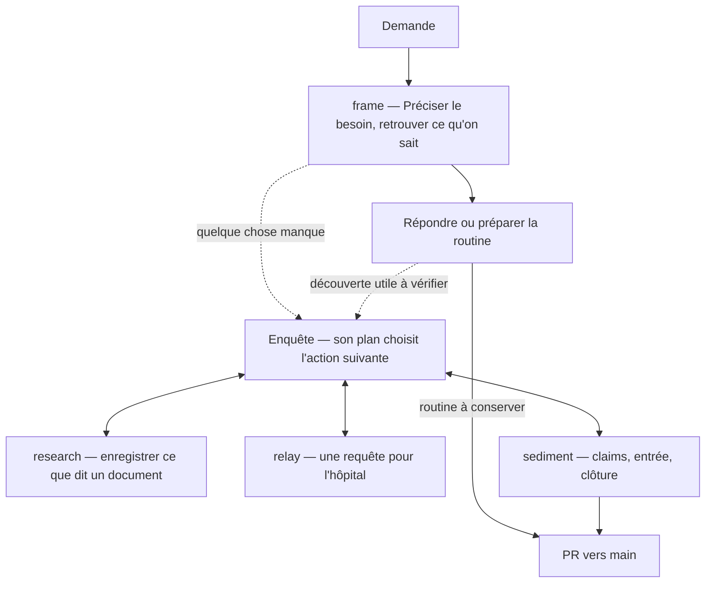

# chu-data-knowledge

Ce qu'on apprend avec un agent sur les données du CHU se perd à la fin de la conversation. Ici, on le garde, en claims : des affirmations, chacune avec ses preuves. La conversation suivante, la vôtre ou celle d'un collègue, part de là.

Pourquoi des preuves : l'infrastructure locale n'est pas documentée, et la documentation de l'éditeur peut se tromper. Une erreur non prouvée passerait dans toutes les conversations suivantes.

Un projet d'équipe du DIM et de l'entrepôt de données, pas institutionnel. Vers avril 2027 : des agents qui travaillent directement dans l'hôpital.

## Votre rôle

Les agents écrivent ; vous posez les questions et décidez. Ils n'atteignent pas l'hôpital : vous exécutez leurs requêtes, et seuls des agrégats en sortent. L'agent mène le travail et vous appelle quand il a besoin de vous :

- **Cadrer :** il vous dit si quelqu'un a déjà posé la question, puis la précise avec vous.
- **Exécuter :** il vous donne une requête et son message. Vérifiez le masquage, exécutez à l'hôpital, rapportez le résultat ; prévenez-le si vous modifiez autre chose que les chemins et la connexion (method/queries.md, « Aller »).
- **Protéger :** aucune donnée qui permette de reconnaître une personne, patient ou personnel, n'entre dans le dépôt ni dans la conversation. Si une telle donnée y arrive, arrêtez et prévenez un mainteneur (method/privacy.md). Le résultat d'une routine, lui, reste à l'hôpital : il peut ne pas être masqué, ne le collez pas dans la conversation (method/queries.md, « Une routine »).
- **Confirmer :** les choix de méthode d'une enquête, puis ce qu'elle fait entrer dans le dépôt (claims et preuves), avant la pull request.
- **Relire au réemploi :** quand un nouveau claim s'appuie sur celui d'un collègue, approuvez le travail que l'agent a refait ; quand il s'appuie sur l'un des vôtres, venu d'une autre enquête, relisez-le dans une nouvelle session (method/review.md).
- **Décider :** suspendre ou fermer l'enquête.
- **Finir :** la retro (plus bas).

Les mainteneurs, Francesco et Pierre, fusionnent les pull requests et décident des règles (AGENTS.md, règle 7). Vocabulaire : method/GLOSSARY.md.

## Commencer

1. Cloner le dépôt, puis `pip install -r requirements.txt`.
2. L'ouvrir avec votre agent. Codex lit AGENTS.md ; Claude Code lit CLAUDE.md, qui y renvoie.
3. Installer les deux skills externes. Les skills du dépôt (frame, research, relay, sediment, retro) arrivent avec lui ; deux autres, writing-for-agents et domain-modeling, s'installent à part, une fois pour tous vos projets (en bas).
4. Poser votre question.

## Le parcours d'une demande



Les pointillés sont des possibilités, pas des étapes. Dans une enquête, research, relay et sediment servent chacune une action, dans l'ordre que le plan demande, autant de fois qu'il faut. Une demande peut finir en réponse, en routine, en claims, ou les trois. Dès qu'elle fait entrer quelque chose dans le dépôt (une routine, des claims), l'agent ouvre une pull request ; un mainteneur la fusionne.

## Finir une session

Quand vous vous arrêtez, l'agent propose la retro : lancez-la (`/retro` dans Claude Code ; avec Codex, demandez-la). Vous cherchez ensemble ce qui a gêné et pourquoi ; il ouvre ou complète une issue friction, dont les mainteneurs se servent pour corriger les règles (method/maintenance.md).

## Le dépôt

Ce qu'on apprend vaut par ses preuves ; la façon de travailler, parce qu'un mainteneur l'a décidée. Chaque fichier va dans le dossier de son type, quel que soit son sujet (référence : method/layout.md).

Ce qu'on apprend :

```text
sources/                une fiche par document, et le texte d'un document hors ligne
knowledge/claims/       un claim par fichier : une affirmation, avec ses preuves
knowledge/evidence/     une preuve par fichier : une lecture ou une exécution
knowledge/queries/      les requêtes préparées pour l'hôpital (.sql, ou .R ou .py pour un fichier)
knowledge/routines/     un calcul qu'on refait : son script R ou Python et sa méthode, un dossier par routine
knowledge/glossaries/   un glossaire par contexte (pmsi, cora…) ; README.md : la carte des contextes
investigations/         une enquête par dossier : son README.md, qui cite ses claims
```

Comment on travaille :

```text
AGENTS.md               règles pour les agents et pointeurs
method/                 les conventions : écrire un claim, une preuve, une requête
method/adr/             les décisions et leurs raisons (ADR : Architecture Decision Record)
.agents/skills/         les skills : frame, research, relay, sediment, retro
checks/                 les contrôles et leurs tests, lancés par les agents et par la CI
```

## Installer les skills externes

<details>
<summary>writing-for-agents et domain-modeling : indispensables aux mainteneurs, conseillées à tous</summary>

L'agent s'en sert pour écrire les règles du dépôt et pour préciser un terme avec vous. Elles viennent de [supermatt](https://github.com/svyatov/supermatt), dérivé des skills de Matt Pocock ; chacun les installe chez soi.

1. Installer Node.js, pour la commande `npx`. Sous Windows : `winget install OpenJS.NodeJS.LTS`, ou l'installateur « LTS » de https://nodejs.org. Rouvrir le terminal : `node --version` doit répondre.
2. Dans un terminal :

   ```bash
   npx skills add svyatov/supermatt -g -a claude-code -a codex -s writing-for-agents -s domain-modeling
   ```

   `-g` les installe dans votre dossier personnel, pour tous vos projets, et non dans le dépôt, à côté de ses propres skills.
3. Vérifier : ~/.claude/skills/ et ~/.agents/skills/ contiennent writing-for-agents et domain-modeling.

Mise à jour : `npx skills update -g writing-for-agents domain-modeling`.

**Si ça bloque :**

- PowerShell refuse `npx` (« l'exécution de scripts est désactivée sur ce système ») : tapez `npx.cmd`, la même commande sans le script que PowerShell bloque.
- Le plugin supermatt complet contient aussi ces deux skills. Ici, ne lancez pas sa commande `setup-supermatt-skills` : elle écrit dans AGENTS.md, qui suit ses propres règles, et dans docs/agents/, que le contrôle refuse.

</details>
