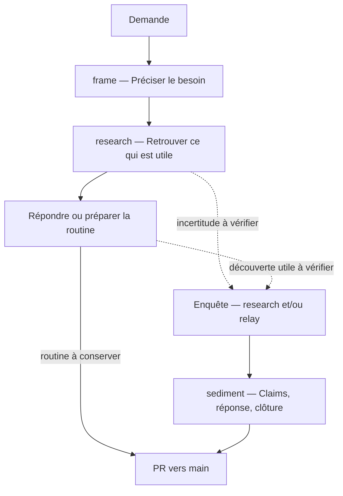

# chu-data-knowledge

On travaille de plus en plus avec un agent IA, et ce qu'on apprend ensemble reste dans la conversation, puis se perd. Ce dépôt est un espace partagé : chacun, avec son agent, y sédimente ce qu'il découvre sur les données du CHU, en claims, des affirmations appuyées sur leurs preuves. La conversation suivante, la sienne ou celle d'un collègue, part de là.

Les preuves comptent ici plus qu'ailleurs : l'infrastructure locale n'est pas documentée, et la documentation de l'éditeur elle-même peut se tromper. Sans preuves, une erreur faite dans une conversation passerait dans toutes les suivantes.

- **Qui :** personnes du DIM et de l'entrepôt de données. Un projet d'équipe, pas institutionnel.
- **Comment :** les agents écrivent ; les personnes posent les questions et décident. Les agents n'atteignent pas l'hôpital : une personne exécute leurs requêtes à l'intérieur et n'en rapporte que des agrégats.
- **Prochaine étape (vers avril 2027) :** des agents qui travaillent directement dans l'hôpital.

Les mots de la méthode (claim, preuve, routine, relay…) : method/GLOSSARY.md.

## Votre rôle

L'agent mène le travail et vous dit quand il a besoin de vous :

- **Cadrer.** Il commence par préciser votre question avec vous.
- **Exécuter à l'hôpital.** Il vous donne une requête avec un message : à quoi elle sert, où l'exécuter, comment elle masque les petits effectifs. Vérifiez le masquage avant d'exécuter, prévenez-le si vous modifiez la requête, puis rapportez-lui le résultat (method/queries.md, « Aller »).
- **Protéger les personnes.** Aucune donnée qui permette de reconnaître une personne, patient ou personnel, n'entre dans le dépôt ni dans la conversation. Si une telle donnée y arrive, arrêtez et prévenez un mainteneur (method/privacy.md).
- **Confirmer.** Avant que les claims d'une enquête entrent, vous relisez avec l'agent ses choix de méthode et vous confirmez.
- **Relire au réemploi.** Quand votre enquête s'appuie sur le claim d'un collègue, l'agent refait le travail et vous l'approuvez ; sur l'un de vos propres claims, il vous demande de le relire dans une nouvelle session (method/review.md).
- **Décider de la suite :** suspendre ou fermer l'enquête.
- **Finir la session** par la retro (plus bas).

Les mainteneurs, Francesco et Pierre, fusionnent les pull requests et décident des règles (AGENTS.md, règle 7).

## Commencer

1. Cloner le dépôt, puis `pip install -r requirements.txt` : l'agent en a besoin pour lancer les contrôles.
2. Ouvrir le dépôt avec votre agent :
   - **Codex** lit AGENTS.md et .agents/skills/.
   - **Claude Code** lit CLAUDE.md, qui renvoie à AGENTS.md, et .claude/skills/.
   - **App web :** créer un projet avec l'instruction « au début, lis AGENTS.md du dépôt et suis ses instructions ». Non testé.
3. Installer les deux skills externes (ci-dessous).
4. Poser votre question.

### Les deux skills externes

writing-for-agents et domain-modeling viennent du paquet [supermatt](https://github.com/svyatov/supermatt), dérivé des skills de Matt Pocock. L'agent s'en sert pour écrire les règles du dépôt et pour préciser un terme avec vous. Indispensables aux mainteneurs, conseillées à tous. Chacun les installe chez soi : le dépôt n'en garde pas de copie.

1. Installer Node.js, qui fournit la commande `npx`. Sous Windows : `winget install OpenJS.NodeJS.LTS` dans un terminal, ou l'installateur « LTS » de https://nodejs.org. Fermer puis rouvrir le terminal : `node --version` doit répondre.
2. Dans un terminal :

   ```bash
   npx skills add svyatov/supermatt -g -a claude-code -a codex -s writing-for-agents -s domain-modeling
   ```

   `-g` les installe dans votre dossier personnel, pour tous vos projets. Sans lui, elles iraient dans .claude/skills/ et .agents/skills/ du dépôt, à côté de ses propres skills.
3. Vérifier : ~/.claude/skills/ et ~/.agents/skills/ contiennent writing-for-agents et domain-modeling.

Pour les mettre à jour : `npx skills update -g writing-for-agents domain-modeling`.

**Si ça bloque :**

- PowerShell refuse `npx` (« l'exécution de scripts est désactivée sur ce système ») : tapez `npx.cmd` à la place. C'est la même commande, sans le script que PowerShell bloque.
- Le plugin supermatt complet, pour Claude Code ou Codex, contient aussi ces deux skills. Dans ce dépôt, ne lancez pas sa commande `setup-supermatt-skills` : elle écrit dans AGENTS.md, qui suit ici ses propres règles, et dans docs/agents/, que le contrôle refuse.

## Le parcours d'une demande

Les skills accompagnent la demande selon ce qu'elle nécessite.



Les flèches pointillées sont des possibilités, pas des étapes obligatoires. Une même demande peut aboutir à une réponse, une routine et des claims, selon ce que le travail révèle.

L'agent ouvre la pull request ; un mainteneur la fusionne.

## Finir une session

Quand vous vous arrêtez, à n'importe quelle étape, faites la retro : l'agent vous la propose, et c'est vous qui la lancez (`/retro` dans Claude Code ; avec Codex, demandez-la). Vous parlez avec lui de ce qui a gêné et de sa cause ; il ouvre ou complète une issue friction sur GitHub. Les mainteneurs s'en servent pour corriger les règles (method/maintenance.md).

## Le dépôt

Deux sortes de fichiers : ce qu'on apprend sur les données du CHU, qui vaut par ses preuves, et la façon de travailler, qui vaut parce qu'un mainteneur l'a décidée. Chaque fichier va dans le dossier de son type, quel que soit son sujet. La référence est method/layout.md.

Ce qu'on apprend :

```text
sources/                une fiche par document, et le texte d'un document hors ligne
knowledge/claims/       un claim par fichier : une affirmation, avec ses preuves
knowledge/evidence/     une preuve par fichier : une lecture ou une exécution
knowledge/queries/      les requêtes préparées pour l'hôpital (.sql, ou .R ou .py pour un fichier)
knowledge/routines/     un calcul qu'on refait : son script R ou Python et sa méthode, un dossier par routine
knowledge/glossaries/   un glossaire par contexte (pmsi, cora…) ; README.md : la carte des contextes
investigations/         une enquête par dossier : son README.md, qui cite ses claims
```

Comment on travaille :

```text
AGENTS.md               règles pour les agents et pointeurs
method/                 les conventions : écrire un claim, une preuve, une requête
method/adr/             les décisions et leurs raisons (ADR : Architecture Decision Record)
.agents/skills/         les étapes : frame, research, relay, sediment, retro
checks/                 les contrôles et leurs tests, lancés par les agents et par la CI
```
